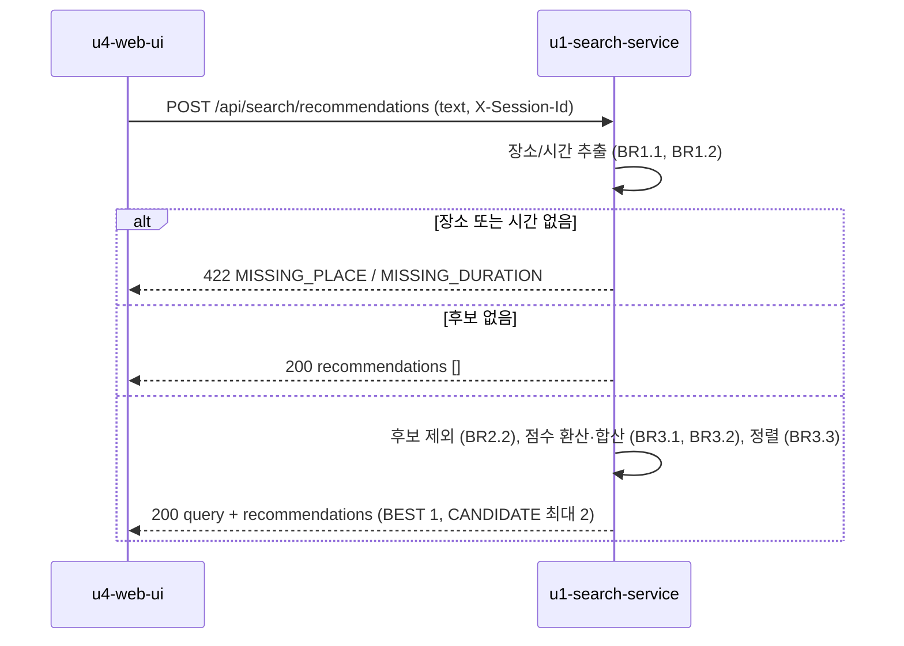

# u1-search-service 기능 명세

## Sources

- [desc] Initial description: 사용자가 음성 텍스트('강남역 근처 2시간 주차권 찾아줘')를 보내면 최적 주차권을 추천하고 결제와 예약을 처리하는 VoiceParking 프로토타입을 만들어 줘.
- [scope] Workflow-selected scope: classic
- [Q1] 종합 점수 가중치 가격 40%, 거리 40%, 이용 시간 적합도 20%
- [memory:M1] unit-of-work.md(U1), stories.md의 US1.1, US2.1, US2.2와 그 인수 조건(AC1.1.1~AC2.2.6), requirements.md, components.md(QueryParser, Recommendation), contract-summary.md(C1, C4), entities.md, rules.md

이 서비스(u1-search-service)가 구현하는 스토리: US1.1(음성 텍스트 해석), US2.1(후보 조회), US2.2(종합 점수 추천). 구현하는 계약: C1 추천 요청(`POST /api/search/recommendations`), C4 주차권 조회(`GET /internal/passes/{passId}?durationHours=`).

이 서비스는 상태를 가지지 않는다. 상태 머신(생명주기를 가진 엔티티)이 없고 모든 요청은 시작할 때 적재한 읽기 전용 목업 데이터로 계산한다.

## 워크플로 W1: 추천 요청 (C1)

1. 요청을 받는다. `X-Session-Id` 헤더가 UUID가 아니면 400 MISSING_SESSION (BR1.6). 본문 `text`가 비었거나 200자를 넘으면 400 INVALID_TEXT (BR1.5).
2. 입력 문장에서 장소를 추출한다 (BR1.1). 없으면 422 MISSING_PLACE로 끝낸다 (BR1.3).
3. 입력 문장에서 이용 시간을 추출한다 (BR1.2). 없으면 422 MISSING_DURATION으로 끝낸다 (BR1.4).
4. 장소가 같은 주차장의 주차권을 모은다 (BR2.1).
5. 이용 가능 최대 시간이 요청 시간보다 짧은 주차권을 뺀다 (BR2.2). 남은 후보가 없으면 빈 목록으로 200 (BR2.3).
6. 후보마다 총액(hourlyPrice × durationHours)과 거리와 시간 차이(availableHours − durationHours)를 구해 후보 간 0~100점으로 환산한다 (BR3.1).
7. 종합 점수를 계산하고 (BR3.2) 정렬하고 (BR3.3) 상위 3개를 BEST 1개와 CANDIDATE 2개로 표시한다 (BR3.4).
8. 각 추천에 이유를 붙인다 (BR3.5). 결과를 200으로 돌려준다.

### 계산 예시 (시험 기준)

요청 "강남역 근처 2시간 주차권 찾아줘"는 목업 데이터에서 다음 결과를 낸다.

| passId | 총액 | 거리 | 시간 차이 | 가격 점수 | 거리 점수 | 시간 적합도 | 종합 | 순위 |
|---|---|---|---|---|---|---|---|---|
| gangnam-public-1 | 6,000 | 120 | 1 | 29.4 | 89.2 | 75.0 | 62 | BEST |
| yeoksam-bldg-1 | 7,000 | 80 | 0 | 0.0 | 100.0 | 100.0 | 60 | CANDIDATE |
| teheran-1 | 5,000 | 300 | 2 | 58.8 | 40.5 | 50.0 | 50 | CANDIDATE |
| sinnonhyeon-1 | 3,600 | 450 | 4 | 100.0 | 0.0 | 0.0 | 40 | (응답에 없음) |

gangnam-private-1은 이용 가능 시간이 1시간뿐이라 후보에서 빠진다 (BR2.2). 최적(gangnam-public-1)의 topFactor는 DISTANCE(기여도 가격 11.8, 거리 35.7, 시간 15.0)다.

## 워크플로 W2: 주차권 조회 (C4)

1. `passId`와 `durationHours`를 받는다. `durationHours`가 없거나 1 미만이면 400 INVALID_DURATION (BR4.2).
2. 주차권이 없으면 404 PASS_NOT_FOUND (BR4.2).
3. `availableHours`가 `durationHours`보다 짧으면 422 DURATION_NOT_AVAILABLE (BR4.2).
4. 주차장 이름과 `price = hourlyPrice × durationHours`를 200으로 돌려준다 (BR4.1).

## 오류 응답 정리

| 상황 | 응답 | 규칙 |
|---|---|---|
| 세션 헤더 없음/형식 오류 | 400 MISSING_SESSION | BR1.6 |
| text가 비었거나 200자 초과 | 400 INVALID_TEXT | BR1.5 |
| 장소 없음 | 422 MISSING_PLACE | BR1.3 |
| 이용 시간 없음 | 422 MISSING_DURATION | BR1.4 |
| 후보 없음 | 200 빈 목록 | BR2.3 |
| 주차권 없음 (C4) | 404 PASS_NOT_FOUND | BR4.2 |
| 이용 시간 못 채움 (C4) | 422 DURATION_NOT_AVAILABLE | BR4.2 |
| 이용 시간 값 오류 (C4) | 400 INVALID_DURATION | BR4.2 |

오류 본문은 모두 contract-summary.md의 공통 오류 형식 `{ code, message }`다.

## Assumptions & Open Questions

- [assumption] 장소 이름은 목업 데이터에 등록된 `placeName`(강남역, 홍대입구역)과 문장의 부분 문자열 일치로 찾는다. 별칭이나 철자 오류는 다루지 않는다. 근거: 목업 데이터를 쓰는 프로토타입.
- [assumption] 이용 시간 표현은 '숫자 시간'과 '한/두/세/네/다섯 시간'만 해석한다. '30분'이나 '반나절'은 이용 시간으로 보지 않아 MISSING_DURATION이 된다.
- [assumption] 목업 주차권의 요금은 시간당 요금 × 시간으로 계산한다. 근거: 요구사항이 요금 체계를 정하지 않았다.
- 열린 질문: 없음. (해석 규칙의 한계는 위 가정에 적었다.)
