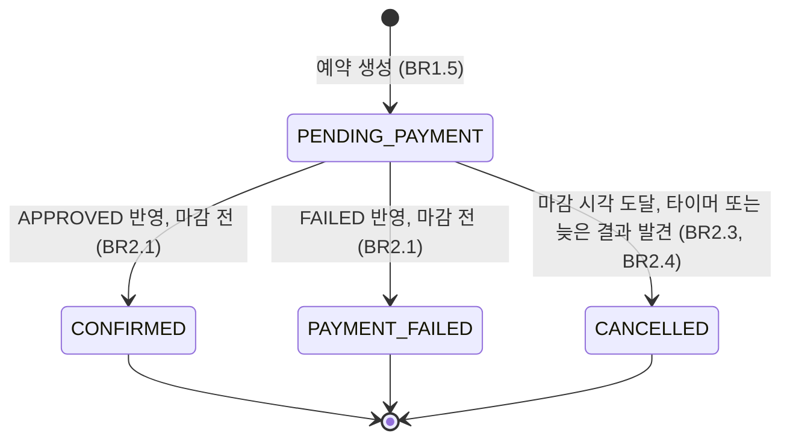
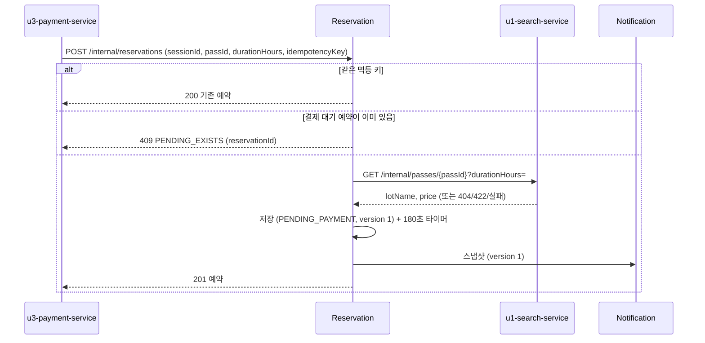
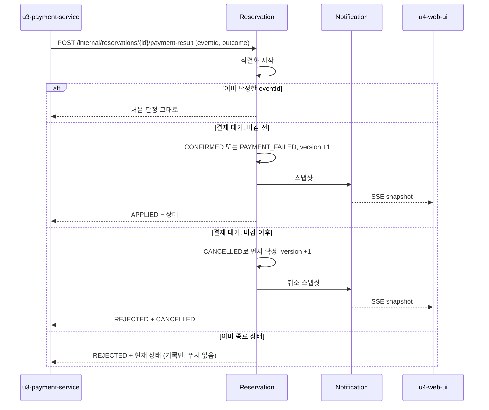
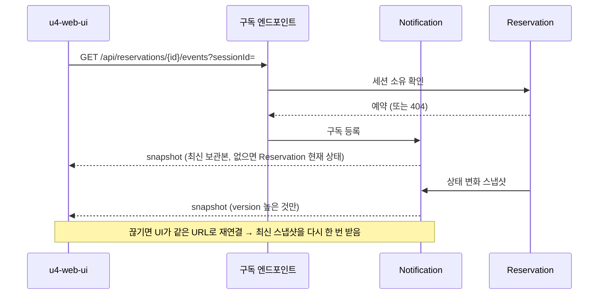

# u2-reservation-service 기능 명세

## Sources

- [desc] Initial description: 사용자가 음성 텍스트('강남역 근처 2시간 주차권 찾아줘')를 보내면 최적 주차권을 추천하고 결제와 예약을 처리하는 VoiceParking 프로토타입을 만들어 줘. 결제가 끝나면 사용자에게 바로 예약 완료를 보여 줘야 해.
- [scope] Workflow-selected scope: classic
- [Q3] 결제 승인은 비동기 웹훅, 승인 후 1초 안에 예약 완료 표시, 180초 안에 승인이 없으면 자동 취소 (requirements-analysis Q3)
- [Q6] 화면 전달은 SSE 서버 푸시 (requirements-analysis Q6)
- [Q7] 180초는 결제 요청 시점부터 (requirements-analysis Q7)
- [memory:M1] unit-of-work.md(U2), stories.md의 US3.1, US3.2, US4.1, US4.2와 그 인수 조건(AC3.1.1~AC4.2.4), requirements.md, components.md(Reservation, Notification, ADR-002), contract-summary.md(C3, C4, C5), entities.md, rules.md

이 서비스(u2-reservation-service)가 구현하는 스토리: US3.1(후보를 골라 결제 요청 중 예약 생성과 대기 표시), US3.2(결제 실패 후 다른 후보로 다시 결제), US4.1(승인 직후 예약 완료), US4.2(승인 지연 자동 취소). 구현하는 계약: C3 예약 조회와 실시간 알림, C5 예약 생성과 결제 결과 반영. 소비하는 계약: C4 주차권 조회(u1-search-service).

이 서비스는 같은 프로세스 안에 두 컴포넌트를 둔다. Reservation은 상태를 확정하는 유일한 곳이고, Notification은 확정된 상태의 스냅샷을 받아 화면으로 보낸다. 두 컴포넌트의 경계(패키지)는 나누며 Notification은 Reservation을 호출하지 않는다.

## 상태 머신: Reservation

| 현재 상태 | 사건 | 조건 | 다음 상태 | 판정 | 푸시 |
|---|---|---|---|---|---|
| (없음) | 예약 생성 | 검증·멱등·결제 대기 제한·주차권 조회 통과 | PENDING_PAYMENT | 201 | 예 (version 1) |
| PENDING_PAYMENT | 결과 APPROVED | 지금 < 마감 | CONFIRMED | APPLIED | 예 |
| PENDING_PAYMENT | 결과 FAILED | 지금 < 마감 | PAYMENT_FAILED | APPLIED | 예 |
| PENDING_PAYMENT | 결과(둘 다) | 지금 >= 마감 | CANCELLED (먼저 확정) | REJECTED | 예 (취소 스냅샷) |
| PENDING_PAYMENT | 마감 타이머 | 지금 >= 마감 | CANCELLED | (해당 없음) | 예 |
| CONFIRMED / PAYMENT_FAILED / CANCELLED | 결과(둘 다) | 처음 보는 eventId | 변화 없음 | REJECTED | 아니오 |
| 모든 상태 | 결과 | 이미 판정한 eventId | 변화 없음 | 처음 낸 판정 그대로 | 아니오 |
| CONFIRMED / PAYMENT_FAILED / CANCELLED | 마감 타이머 | (해제됨, 울려도 무시) | 변화 없음 | (해당 없음) | 아니오 |

마감 = paymentRequestedAt + 180초. 마감 시각과 같은 시각이면 취소가 이긴다(BR2.3).

### 상태별 안내 문구 (message)

| status | message |
|---|---|
| PENDING_PAYMENT | 결제 승인을 기다리는 중입니다 |
| CONFIRMED | 예약이 완료되었습니다 |
| PAYMENT_FAILED | 결제가 거절되었습니다. 다른 주차권을 선택해 다시 결제해 주세요 |
| CANCELLED | 승인 지연으로 예약이 취소되었습니다 |

## 워크플로 W1: 대기 예약 생성 (C5, U3 호출)

1. 요청(sessionId, passId, durationHours, idempotencyKey)을 받는다. 형식이 틀리면 400 INVALID_REQUEST (BR1.1).
2. (sessionId, idempotencyKey)로 만든 예약이 있으면 그 예약을 200으로 돌려주고 끝낸다 (BR1.2).
3. 같은 세션에 결제 대기 예약이 있으면 409 PENDING_EXISTS와 기존 reservationId (BR1.3).
4. u1에 주차권을 조회한다(제한 시간 2초, 200ms 간격 최대 2회 재시도). 없으면 404, 시간을 못 채우면 422, 실패하면 502 (BR1.4).
5. 세션 단위 직렬화 안에서 결제 대기 제한을 다시 확인하고 예약을 저장한다. 결제 대기, version 1, paymentRequestedAt = 지금, 마감 타이머 예약 (BR1.5, BR5.2). 사이에 다른 예약이 생겼으면 409 PENDING_EXISTS.
6. 첫 스냅샷을 푸시하고(BR4.1) 201로 reservationId, status, amount, durationHours, lotName, paymentRequestedAt을 돌려준다.

## 워크플로 W2: 결제 결과 반영 (C5, U3 호출)

1. 요청(reservationId 경로, eventId, outcome)을 받는다. 형식이 틀리면 400 INVALID_REQUEST. 예약이 없으면 404 NOT_FOUND (BR2.1).
2. 예약 단위 직렬화 안에서 같은 eventId의 판정 기록이 있으면 처음 판정을 그대로 돌려주고 끝낸다 (BR2.1, 멱등).
3. 예약이 결제 대기이고 지금이 마감 이후이면 먼저 CANCELLED로 확정하고 취소 스냅샷을 푸시한다 (BR2.3, BR2.4).
4. 예약이 결제 대기이면 outcome에 따라 CONFIRMED 또는 PAYMENT_FAILED로 바꾸고 version을 올리고 스냅샷을 푸시한다. result = APPLIED (BR2.1).
5. 그 밖의 상태이면 상태를 바꾸지 않고 result = REJECTED로 하고 기록한다 (BR2.2).
6. 판정을 AppliedPaymentEvent로 남기고 `{ result, reservationStatus }`를 200으로 돌려준다.

## 워크플로 W3: 180초 자동 취소

1. 예약이 만들어지면 마감 시각(paymentRequestedAt + 180초)에 울릴 타이머를 예약한다 (BR1.5).
2. 타이머가 울리면 예약 단위 직렬화 안에서 상태를 확인한다. 결제 대기이면 CANCELLED로 바꾸고 안내 문구 '승인 지연으로 예약이 취소되었습니다'를 붙여 스냅샷을 푸시한다 (BR2.4).
3. 이미 CONFIRMED, PAYMENT_FAILED, CANCELLED이면 아무것도 하지 않는다. 예약이 결제 대기를 벗어날 때 타이머는 해제한다.
4. 타이머가 지연되어도 W2의 3단계가 시계로 마감을 판정하므로 마감 이후의 승인이 예약을 확정하는 일은 없다 (BR2.3).

## 워크플로 W4: 조회와 실시간 알림 (C3, U4 호출)

현재 예약 조회와 단건 조회:

1. 헤더 X-Session-Id가 없거나 UUID가 아니면 401 MISSING_SESSION (BR3.1).
2. `GET /api/reservations/current`는 세션의 가장 최근 예약 상태를 200으로, 없으면 404 NO_RESERVATION (BR3.3).
3. `GET /api/reservations/{reservationId}`는 세션이 소유한 예약이면 200, 없거나 다른 세션의 것이면 404 NOT_FOUND (BR3.2).

구독 (`GET /api/reservations/{reservationId}/events`):

1. 세션을 헤더 또는 쿼리 sessionId에서 읽는다. 둘 다 없으면 401 MISSING_SESSION. 헤더가 우선한다 (BR3.1).
2. 예약이 없거나 다른 세션의 것이면 404 NOT_FOUND (BR3.2).
3. 연결을 열고 보관 중인 최신 스냅샷을 이벤트 이름 `snapshot`, id = version으로 먼저 한 번 보낸다. 보관 중인 것이 없으면 Reservation의 현재 상태로 스냅샷을 만들어 보낸다 (BR4.3).
4. 이후 상태 변화마다 Notification이 스냅샷을 보낸다. version이 높은 것만 보관·전송한다 (BR4.1, BR4.2). 15초 동안 보낼 이벤트가 없으면 `: keep-alive` 주석을 보낸다 (BR4.5).
5. 쓰기 실패나 끊김은 그 연결만 제거한다 (BR4.4). 화면은 같은 URL로 다시 연결하면 3단계에서 최신 스냅샷을 다시 받는다.

## 스냅샷 형식 (C3 Reservation)

`reservationId`, `version`, `status`, `lotName`, `durationHours`, `amount`, `paymentRequestedAt`은 항상 있고, `confirmedAt`은 CONFIRMED일 때, `cancelledAt`은 CANCELLED일 때, `message`는 항상 있다. PAYMENT_FAILED일 때는 `confirmedAt`과 `cancelledAt`이 없다. 푸시 이벤트와 조회 응답이 같은 형식이다.

## 1초 예산에서 이 서비스의 시험 기준

웹훅 수신 → 화면 표시 1초(NFR1) 가운데 이 서비스가 쓰는 구간은 "결제 결과 반영 요청을 받은 때부터 스냅샷이 구독 연결에 쓰인 때까지"이며 로컬 100건 반복의 최댓값이 150ms 이내여야 한다 (BR4.6). 구독 연결이 있는 상태에서 측정하고, 구독 연결이 없을 때는 상태 확정까지만 측정한다.

## 오류 응답 정리

| 상황 | 응답 | 규칙 |
|---|---|---|
| 예약 생성 요청 형식 오류 | 400 INVALID_REQUEST | BR1.1 |
| 세션에 결제 대기 예약이 이미 있음 (다른 키) | 409 PENDING_EXISTS (+ reservationId) | BR1.3 |
| 주차권 없음 (C4) | 404 PASS_NOT_FOUND | BR1.4 |
| 주차권이 이용 시간을 못 채움 (C4) | 422 DURATION_NOT_AVAILABLE | BR1.4 |
| u1 호출 실패 | 502 UPSTREAM_FAILED | BR1.4 |
| 결제 결과 요청 형식 오류 | 400 INVALID_REQUEST | BR2.1 |
| 결제 결과의 예약 없음 | 404 NOT_FOUND | BR2.1 |
| 세션 식별자 없음/형식 오류 (조회·구독) | 401 MISSING_SESSION | BR3.1 |
| 예약 없음, 다른 세션의 예약 | 404 NOT_FOUND | BR3.2 |
| 세션의 예약이 하나도 없음 | 404 NO_RESERVATION | BR3.3 |

결제 결과가 이미 종료된 예약에 온 경우는 오류가 아니다. 200과 `result = REJECTED`로 답한다 (BR2.2). 오류 본문은 모두 contract-summary.md의 공통 오류 형식 `{ code, message }`다.

## 시험 기준 요약 (TDD 시작점)

| 장면 | 기대 | 규칙 |
|---|---|---|
| 같은 승인 이벤트 3번 | 첫 번째만 APPLIED, 다음 둘은 같은 판정을 그대로 돌려주고 CONFIRMED는 1번, 푸시 1번 | BR2.1, AC4.1.2 |
| 서로 다른 eventId의 승인 두 번 | 첫 번째 APPLIED, 두 번째 REJECTED(CONFIRMED) | BR2.2 |
| 179초 승인 | CONFIRMED, 자동 취소 없음 | BR2.3, AC4.2.2 |
| 180초 승인 | CANCELLED, REJECTED | BR2.3 |
| 181초 승인 | CANCELLED, REJECTED, 되살아나지 않음 | BR2.3, AC4.2.3 |
| 타이머가 182초에 늦게 울리지만 181초 승인이 먼저 도착 | 승인 요청이 CANCELLED로 확정한 뒤 REJECTED | BR2.3 |
| 승인과 타이머가 동시 | 정확히 하나만 이긴다. CONFIRMED와 CANCELLED가 동시에 일어나지 않음 | BR5.2 |
| 결제 요청 후 180초에 취소 | 취소 시각이 178~182초 안, 안내 문구 포함 | BR2.4, AC4.2.4 |
| 실패 결과 | PAYMENT_FAILED, 안내 문구, 이후 새 예약 생성 가능 | BR2.1, BR2.6 |
| 실패한 예약이 시간이 지난 뒤 | 여전히 PAYMENT_FAILED | BR2.5, AC3.2.3 |
| 같은 세션에 결제 대기 중 다른 키로 생성 | 409, 새 예약 없음 | BR1.3, AC3.1.3 |
| 같은 세션에 같은 키 재요청 | 같은 예약 200, 타이머·푸시 추가 없음 | BR1.2 |
| 푸시 재연결 | 최신 스냅샷을 먼저 한 번 받음 | BR4.3, AC4.1.4 |
| 다른 세션의 reservationId 조회·구독 | 404 | BR3.2 |
| 낮은 version 스냅샷 | 보관·전송하지 않음 | BR4.2 |

## Assumptions & Open Questions

- [assumption] 저장소는 인메모리이며 서비스를 다시 시작하면 예약과 타이머가 사라진다. 사라진 결제 대기 예약의 타이머를 복구하지 않는다. 근거: 프로토타입, 로컬 실행, 요구사항이 영속성을 요구하지 않는다 (BR5.3).
- [assumption] `paymentRequestedAt`은 이 서비스가 예약 생성을 저장한 시각이다. u3가 예약을 먼저 만든 뒤 모의 PG에 요청하므로 "결제 요청 시점"과 모의 PG 호출 시점의 차이는 로컬에서 무시할 수 있다고 본다 (NFR2의 ±2초 안).
- [assumption] 마감 시각과 같은 시각에 도착한 결과는 취소가 이긴다 (BR2.3). 근거: AC4.2.3의 경계 규칙("취소가 먼저 확정되면 이후 승인은 무시")을 시계 기준으로 결정적으로 만든 것이다.
- [assumption] 1초 예산에서 이 서비스 몫 150ms는 계약 C3의 구간 값을 그대로 시험 기준으로 쓴 것이며 사용자 확인 전까지 가정이다 (BR4.6).
- [assumption] 세션 식별자가 없거나 UUID가 아니면 401 MISSING_SESSION으로 통일한다. 계약 C3가 구독 엔드포인트에만 401을 명시했으므로 같은 서비스의 다른 조회 엔드포인트도 이에 맞췄다. u1-search-service는 같은 코드 이름을 400으로 쓴다(BR1.6). 서비스마다 상태 코드가 다른 점은 화면이 코드 이름(`MISSING_SESSION`)으로 처리하면 문제없다.
- [assumption] 종료 상태(CONFIRMED, PAYMENT_FAILED, CANCELLED)가 된 예약의 구독 연결을 서버는 닫지 않는다. 화면(u4-web-ui)이 종료 상태 스냅샷을 받으면 스스로 연결을 닫는다. 연결을 서버가 닫으면 브라우저가 자동 재연결을 반복하기 때문이다.
- [assumption] SSE 연결 유지 신호는 15초 간격 주석 줄이다. 이 간격은 Vite 프록시의 유휴 제한을 확인하기 전의 값이다. 계약 C3의 열린 질문(프록시가 SSE를 버퍼링하지 않는지)은 u4-web-ui와 u5-local-run에서 확인한다.
- 열린 질문: 없음. 위 가정 가운데 사용자 확인이 필요한 것은 1초 예산 구간 값과 인메모리 저장소 두 건이며, 확인되지 않아도 이 설계는 그대로 진행할 수 있다.
