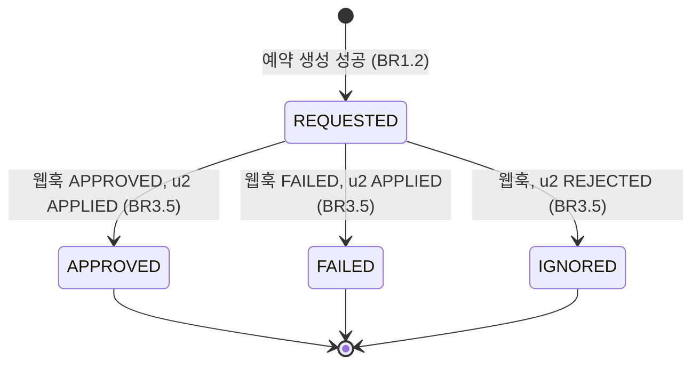
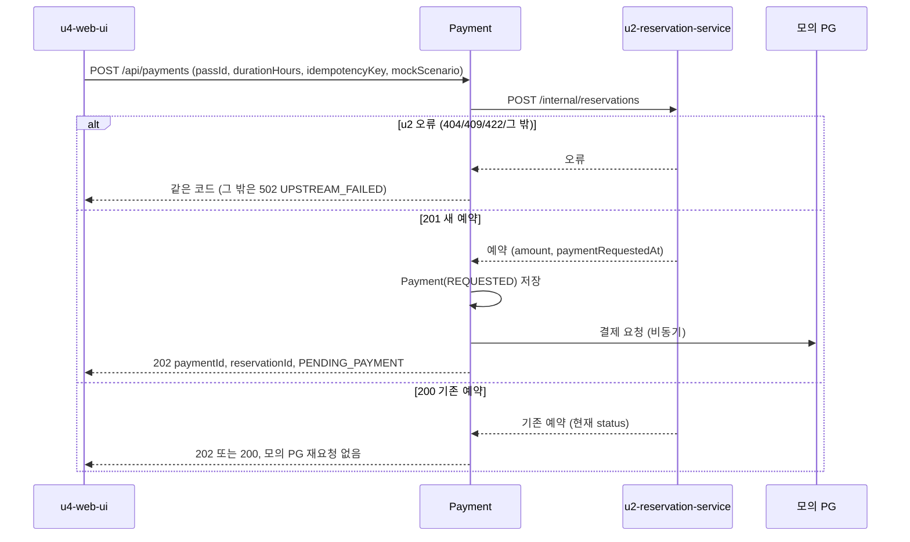
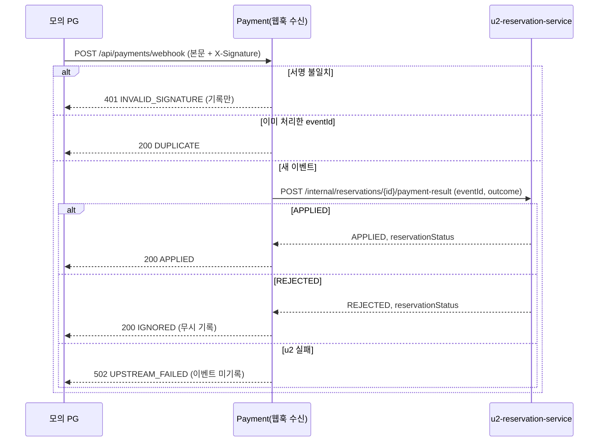

# u3-payment-service 기능 명세

## Sources

- [desc] Initial description: 사용자가 음성 텍스트('강남역 근처 2시간 주차권 찾아줘')를 보내면 최적 주차권을 추천하고 결제와 예약을 처리하는 VoiceParking 프로토타입을 만들어 줘. 결제가 끝나면 사용자에게 바로 예약 완료를 보여 줘야 해.
- [scope] Workflow-selected scope: classic
- [Q2] 모의 PG는 payment-service 안에 두되 승인·실패 결과를 자기 웹훅 엔드포인트에 HTTP로 비동기 호출 (units-generation Q2)
- [memory:M1] unit-of-work.md(U3), stories.md의 US3.1, US3.2, US4.1과 그 인수 조건(AC3.1.1~AC4.1.5), requirements.md, components.md(Payment, ADR-002, ADR-003, ADR-005), contract-summary.md(C2, C5, C6), entities.md, rules.md, u2-reservation-service의 code-summary.md(구현된 C5 동작)

이 서비스(u3-payment-service)가 구현하는 스토리: US3.1(후보를 골라 결제 요청 — 대기 예약 생성과 모의 PG 요청), US3.2(결제 실패를 예약 서비스에 전달, 실패 뒤 새 결제 허용), US4.1(승인 웹훅 수신, 검증, 멱등 처리, 예약 반영). 구현하는 계약: C2 결제 요청(`POST /api/payments`), C6 웹훅 수신(`POST /api/payments/webhook`). 소비하는 계약: C5 예약 생성과 결제 결과 반영(u2-reservation-service).

이 서비스는 같은 프로세스 안에 모의 PG를 둔다. 모의 PG는 코드 경계를 나눠 인터페이스 하나 뒤에 두며(BR2.2), 이 서비스의 웹훅 수신부와 Payment 로직은 모의 PG를 참조하지 않는다.

## 상태 머신: Payment

Payment.status는 PG가 알려 준 결과의 기록이며 사용자에게 보이는 예약 상태의 기준은 Reservation.status다. 이 서비스는 예약 상태를 읽어 결제 상태를 정하지 않는다.

| 현재 Payment 상태 | 사건 | 조건 | 다음 | 웹훅 응답 |
|---|---|---|---|---|
| (없음) | 결제 요청 | u2가 201 | REQUESTED | (결제 요청 응답 202) |
| REQUESTED | 웹훅 | 서명 맞음, 새 eventId, u2 APPLIED | APPROVED 또는 FAILED | 200 APPLIED |
| REQUESTED | 웹훅 | 서명 맞음, 새 eventId, u2 REJECTED | IGNORED | 200 IGNORED |
| REQUESTED | 웹훅 | 서명 맞음, 새 eventId, u2 실패 | REQUESTED 유지 | 502 UPSTREAM_FAILED |
| 모든 상태 | 웹훅 | 이미 처리한 eventId | 변화 없음 | 200 DUPLICATE |
| 모든 상태 | 웹훅 | 서명 안 맞음 | 변화 없음 | 401 INVALID_SIGNATURE |

## 워크플로 W1: 결제 요청 (C2, u4 호출)

1. 요청(X-Session-Id, passId, durationHours, idempotencyKey, mockScenario, mockDelaySeconds)을 받는다. 형식이 틀리면 400 (BR1.1).
2. u2에 대기 예약을 만든다(C5). 제한 2초, 자동 재시도 없음. 오류이면 BR1.4로 전하고 끝낸다.
3. u2가 201이면 새 Payment(REQUESTED)를 만들고 모의 PG에 요청한 뒤 202로 paymentId, reservationId, status PENDING_PAYMENT, paymentRequestedAt을 돌려준다 (BR1.2).
4. u2가 200(기존 예약)이면 새 결제도 새 모의 PG 요청도 만들지 않는다. 같은 키로 만든 Payment가 있으면 그 paymentId를 쓰고, 없으면 만들되 예약이 결제 대기일 때만 모의 PG를 요청한다. u2가 돌려준 현재 status를 담아 status가 PENDING_PAYMENT이면 202, 아니면 200으로 돌려준다 (BR1.3).

## 워크플로 W2: 모의 PG 알림

1. 새 Payment에 대한 모의 PG 요청을 받는다 (BR2.1).
2. 시나리오에 따라 대기한다: APPROVE는 바로, DELAY는 mockDelaySeconds 뒤(0이면 200초), FAIL은 바로.
3. 결과 APPROVED(APPROVE, DELAY) 또는 FAILED(FAIL)를 담은 웹훅 호출 값을 만들고 본문 원문 바이트를 HMAC-SHA256으로 서명해 이 서비스의 웹훅 주소로 비동기 HTTP로 보낸다. 오류를 받아도 다시 보내지 않는다.

## 워크플로 W3: 웹훅 수신 (C6)

1. 본문 원문 바이트를 읽고 서명을 상수 시간으로 검증한다. 틀리면 401 INVALID_SIGNATURE, 상태 변화 없음, 거부 로그 (BR3.1).
2. 본문을 해석하고 형식을 검증한다. 틀리면 400. paymentId를 모르면 404 UNKNOWN_PAYMENT (BR3.3).
3. 같은 eventId의 처리를 직렬화한다. 이미 기록된 eventId이면 200 DUPLICATE로 끝낸다 (BR3.4).
4. u2의 결제 결과 반영을 호출한다(제한 2초, 200ms 간격 최대 2회 재시도). 실패하면 502, 기록하지 않는다 (BR3.6).
5. APPLIED이면 WebhookEvent와 Payment.status를 기록하고 200 APPLIED. REJECTED이면 IGNORED로 기록하고 무시한 사실을 로그에 남기고 200 IGNORED (BR3.5).

## 오류 응답 정리

| 상황 | 응답 | 규칙 |
|---|---|---|
| 세션 헤더 없음/형식 오류 (C2) | 400 MISSING_SESSION | BR1.1 |
| 결제 요청 형식 오류 | 400 INVALID_REQUEST | BR1.1 |
| 주차권 없음 (u2 전달) | 404 PASS_NOT_FOUND | BR1.4 |
| 세션에 결제 대기 예약이 이미 있음 (u2 전달) | 409 PENDING_EXISTS (+ reservationId) | BR1.4 |
| 주차권이 이용 시간을 못 채움 (u2 전달) | 422 DURATION_NOT_AVAILABLE | BR1.4 |
| u2 호출 실패 (결제 요청) | 502 UPSTREAM_FAILED | BR1.4 |
| 웹훅 서명 불일치 | 401 INVALID_SIGNATURE | BR3.1 |
| 웹훅 형식 오류 | 400 INVALID_REQUEST | BR3.3 |
| 웹훅의 결제를 모름 | 404 UNKNOWN_PAYMENT | BR3.3 |
| u2 반영 실패 (웹훅) | 502 UPSTREAM_FAILED | BR3.6 |

오류 본문은 모두 contract-summary.md의 공통 오류 형식 `{ code, message }`다. 웹훅 처리 결과(APPLIED, DUPLICATE, IGNORED)는 오류가 아니라 200이다.

## 시험 기준 요약 (TDD 시작점)

| 장면 | 기대 | 규칙 |
|---|---|---|
| 새 결제 요청 | u2 호출 1회, Payment REQUESTED, 모의 PG 요청 1회, 202 | BR1.2 |
| 같은 키 재요청 (u2가 기존 예약 200) | 새 Payment·새 모의 PG 요청 없음, 같은 paymentId | BR1.3 |
| u2가 종료된 예약을 돌려줌 | 모의 PG 재요청 없음, 200과 현재 status | BR1.3 |
| u2 409·404·422·502 | 같은 코드 전달(그 밖은 502), Payment 없음 | BR1.4 |
| FAIL 시나리오 | 모의 PG가 FAILED 웹훅, u2에 FAILED 전달, Payment FAILED | BR2.1, BR3.5 |
| 실패 뒤 새 키로 요청 | 새 Payment 생성 | BR1.5 |
| 올바른 서명의 승인 웹훅 | u2 호출 1회, 200 APPLIED, Payment APPROVED | BR3.5 |
| 같은 승인 웹훅 3번 | u2 호출 1회, 둘째·셋째 DUPLICATE | BR3.4 |
| 같은 이벤트 동시 3건 | u2 호출 1회 | BR3.4 |
| 틀린 서명, 서명 없음 | 401, 상태·기록 변화 없음, 거부 로그(본문·서명 값 없음) | BR3.1 |
| 알 수 없는 paymentId | 404 UNKNOWN_PAYMENT | BR3.3 |
| u2가 REJECTED | 200 IGNORED, Payment IGNORED, 무시 로그 | BR3.5 |
| u2 실패 | 502, 이벤트 미기록, 같은 이벤트 재전송 시 처음부터 처리 | BR3.6 |
| 비밀 값 없이 기동 | 기동 거부 | BR3.2 |
| 웹훅 처리 시간 | 100회 최댓값 150ms 이내 | BR3.7 |
| 모의 PG 패키지 의존 | Payment·웹훅 패키지가 모의 PG 패키지를 참조하지 않음 | BR2.2 |

## Assumptions & Open Questions

- [assumption] DELAY 시나리오에서 mockDelaySeconds가 0이면 200초 지연으로 본다. 근거: 지연 시나리오의 목적이 180초 자동 취소를 재현하는 것이며 0초면 APPROVE와 같아진다.
- [assumption] 같은 키 재요청에서 u2가 종료된 예약을 돌려주면 200과 현재 status를 담아 돌려준다. 계약 C2의 202·PENDING_PAYMENT 고정과 다르며 u4가 알아야 한다 (u2의 D1에서 이어진 계약 확장).
- [assumption] 모의 PG의 자기 호출은 외부 PG가 호출하는 것과 같은 서명 검증을 거친다 (units-generation 가정). 모의 PG는 실제 HTTP로 자기 웹훅 주소를 부른다.
- [assumption] 웹훅 처리 150ms 구간 값은 계약 C3의 1초 예산 가정을 시험 기준으로 쓴 것이며 사용자 확인 전까지 가정이다 (BR3.7).
- [assumption] 인메모리 저장소이므로 재시작 시 결제 기록과 예약된 모의 PG 알림이 사라진다.
- 열린 질문: 없음. 위 가정은 확인되지 않아도 이 설계를 그대로 진행할 수 있다.
