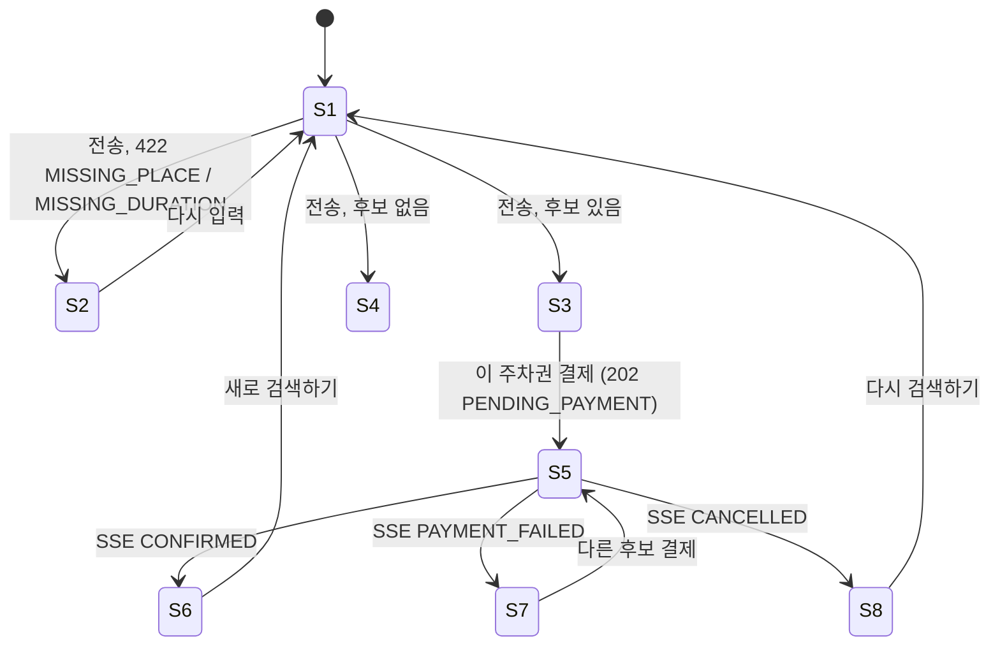

# u4-web-ui 기능 명세

## Sources

- [desc] Initial description: 사용자가 음성 텍스트('강남역 근처 2시간 주차권 찾아줘')를 보내면 최적 주차권을 추천하고 결제와 예약을 처리하는 VoiceParking 프로토타입을 만들어 줘. 프런트는 Vue 3로 하고, 결제가 끝나면 사용자에게 바로 예약 완료를 보여 줘야 해.
- [scope] Workflow-selected scope: classic
- [Q3] 화면은 Vite 개발 서버 프록시로 각 서비스에 연결 (units-generation Q3)
- [Q1] 텍스트 입력창과 전송 버튼, 마이크 버튼 없음 (refined-mockups Q1)
- [Q2] UI 라이브러리 없음, 직접 작성한 CSS (refined-mockups Q2)
- [Q3] 데스크톱 중심, 기본 접근성 (refined-mockups Q3)
- [memory:M1] unit-of-work.md(U4), stories.md의 US1.1~US4.2와 그 인수 조건(AC1.1.1~AC4.2.4), requirements.md(FR1~FR8, NFR1), refined-mockups/(mockups.md, interaction-spec.md, accessibility-checklist.md, design-system-mapping.md), contract-summary.md(C1, C2, C3), u1·u2·u3의 code-summary.md(구현된 계약)

이 유닛(u4-web-ui)이 구현하는 스토리: US1.1(말하기), US2.1·US2.2(후보와 추천 보기), US3.1(결제 요청), US3.2(실패 뒤 다른 후보로 다시 결제), US4.1(승인 직후 예약 완료), US4.2(자동 취소 안내). 화면은 표시와 입력만 맡고 규칙과 상태는 서비스가 맡는다. 소비하는 계약: C1 추천 요청(u1), C2 결제 요청(u3), C3 예약 조회와 실시간 알림(u2).

이 문서는 UI 전용 유닛이라 `entities.md`·`rules.md` 없이 화면의 상호작용 규칙과 상태 전이를 스스로 완결되게 정한다. 규칙 번호는 `UR{묶음}.{번호}`이며 `rules.md`(추적 도구가 읽는 형식)의 `BR{묶음}.{번호}`와 번호가 같다(`UR2.3` = `BR2.3`). 서술의 원본은 이 문서이고 `rules.md`는 같은 규칙의 짧은 요약이다. 컴포넌트 구조와 props는 `frontend-components.md`가 정한다.

## 화면 상태 머신

화면은 한 페이지다. 입력 영역은 항상 보이고 아래에서 두 영역이 상태에 따라 나타난다. **결과 영역**은 S2·S3·S4를, **예약 상태 영역**은 S5·S6·S7·S8을 보인다. 두 영역은 서로 독립적으로 보일 수 있다(UR3.4).

| 상태 | 영역 | 의미 | 스토리 |
|---|---|---|---|
| S1 | 결과 | 입력 대기 | US1.1 |
| S2 | 결과 | 해석 오류 (장소 또는 시간 없음) | US1.1 |
| S3 | 결과 | 추천 결과 (최적 1 + 비교 후보 최대 2) | US2.1, US2.2 |
| S4 | 결과 | 후보 없음 | US2.1 |
| S5 | 예약 상태 | 결제 승인 대기 | US3.1 |
| S6 | 예약 상태 | 예약 완료 | US4.1 |
| S7 | 예약 상태 | 결제 실패 | US3.2 |
| S8 | 예약 상태 | 자동 취소 | US4.2 |

| 현재 | 이벤트 | 다음 | 근거 |
|---|---|---|---|
| S1·S2·S3·S4 | 입력 전송, 장소·시간 모두 있음 | S3 또는 S4 | AC1.1.1, AC2.1.3 |
| S1·S3·S4 | 입력 전송, 장소 또는 시간 없음 | S2 | AC1.1.2, AC1.1.3 |
| S3 | 후보 카드 "이 주차권 결제" | S5 | AC3.1.1 |
| S5 | SSE로 CONFIRMED | S6 | AC4.1.1 |
| S5 | SSE로 PAYMENT_FAILED | S7 | AC3.2.1 |
| S5 | SSE로 CANCELLED | S8 | AC4.2.1 |
| S7 | 다른 후보 결제 | S5 | AC3.2.2 |
| S6·S8 | 새로 검색하기·다시 검색하기 | S1 | 인터랙션 명세 |
| (처음 열기·새로 고침) | 세션의 현재 예약 조회 | 상태에 따라 S5~S8 | AC4.1.4 |

## 두 영역의 조합 (UR3.4)

화면 상태는 `resultView`(idle, interpretError, results, empty) × `reservationView`(none, pending, confirmed, failed, cancelled)의 곱이다. 두 영역은 서로 다른 이벤트로만 바뀐다. 위 단일 기계 그림은 한 흐름의 대표 경로이고, 아래 표가 곱 상태의 전이를 완성한다.

| 이벤트 | resultView | reservationView |
|---|---|---|
| 추천 응답 200(후보 있음/없음) | results/empty | 변하지 않음 (pending이면 pending 유지, 결제 버튼은 비활성) |
| 추천 응답 422 | interpretError, 추천 목록 비움 | 변하지 않음. failed이면 failed 유지 |
| 추천 요청 오류(네트워크·5xx) | 변하지 않음 | 변하지 않음 |
| 결제 202 (또는 200+PENDING_PAYMENT) | 변하지 않음 | pending (confirmed·failed·cancelled에서도 pending이 된다) |
| 결제 200 + 종료 상태 | 변하지 않음 | 해당 종료 상태(단건 조회로 채움) |
| 구독 스냅샷 CONFIRMED·PAYMENT_FAILED·CANCELLED | 변하지 않음 | confirmed·failed·cancelled |
| 새로 검색하기·다시 검색하기 | idle | none |
| 처음 열기 복원 | 저장된 추천 목록이 있으면 results, 없으면 idle | 현재 예약에 따라 |

failed 상태(S7)에서 추천 목록이 있으면(`resultView`가 results) 실패 안내 아래에서 다른 후보를 고른다. 목록이 없으면(새로 고침 뒤 복원 실패, 저장소 불가, 422로 비워진 경우) `ReservationStatus`가 "새로 검색하기" 단추를 보여 S1로 나갈 수 있다 (UR5.1). S6·S7·S8이 보이는 채로 새 검색을 하고 결제하면 pending이 된다.

## 워크플로 W1: 세션과 처음 열기 (AC1.1.4, AC4.1.4)

1. 브라우저 세션 저장소(sessionStorage)에 세션 ID가 없으면 UUID를 만들어 저장한다. 같은 탭이 새로 고쳐져도 같은 ID를 쓴다 (UR1.1). 저장소를 쓸 수 없으면(차단 등) 만든 ID를 메모리에 유지해 요청마다 새로 만들지 않는다. 새로 고침 복원은 되지 않는다.
2. 모든 서비스 요청에 헤더 `X-Session-Id`를 붙인다. SSE는 헤더를 보낼 수 없어 쿼리 `sessionId`로 보낸다 (UR1.2).
3. 처음 열 때 `GET /api/reservations/current`를 부른다. 404 NO_RESERVATION이면 S1이다. 예약이 있으면 상태에 따라 S5~S8을 보이고 PENDING_PAYMENT이면 같은 예약의 SSE 구독을 시작한다 (UR1.3).
4. 저장된 마지막 추천 목록(sessionStorage)이 있으면 결과 영역에 S3으로 복원한다 (UR1.4).

## 워크플로 W2: 말하기와 추천 (C1, US1.1~US2.2)

1. 입력창에 텍스트를 쓴다. 빈 입력(공백만 포함)이면 전송 버튼이 비활성이다. 최대 200자다 (UR2.1).
2. 전송(버튼 또는 엔터)하면 `POST /api/search/recommendations`를 `{ text }`로 부른다. 응답을 기다리는 동안 전송 버튼이 비활성이고 "찾는 중..." 문구를 보인다 (UR2.2).
3. 200이고 `recommendations`가 비어 있지 않으면 S3: 최적(BEST) 카드 1개와 비교 후보(CANDIDATE) 카드를 서버가 준 순서대로 보인다 (UR2.3). 비어 있으면 S4 "조건에 맞는 주차권이 없습니다. 장소나 시간을 바꿔 다시 말해 주세요."를 보인다 (UR2.4).
4. 422 MISSING_PLACE는 "장소를 알려 주세요. 예: "강남역 근처 2시간"", 422 MISSING_DURATION은 "이용 시간을 알려 주세요. 예: "강남역 근처 2시간""를 S2로 보인다. 추천은 수행되지 않았으므로 이전 추천 목록은 비운다 (UR2.5).
5. 그 밖의 오류(네트워크, 400, 5xx, 3초 제한 시간 초과)는 "잠시 후 다시 시도해 주세요" 안내와 다시 전송을 허용한다. 안내는 입력 영역 아래에 보이고 이전 결과는 유지한다 (UR2.6).

### 카드 표시 (UR2.3)

| 항목 | 표시 |
|---|---|
| 순위 | BEST이면 "최적 추천", CANDIDATE이면 "비교 후보" |
| 이름 | `lotName` |
| 요금 | `{query.durationHours}시간 {price 천 단위 구분}원` (price는 이용 시간 전체 합계) |
| 거리 | `{distanceMeters}m` |
| 점수 | `종합 {score}점` |
| 이유 | `reason.text`를 그대로 보인다 (가장 큰 기여 항목의 이름이 이미 들어 있다, AC2.2.5) |
| 버튼 | "이 주차권 결제" |

후보가 3개 미만이면 있는 카드만 보인다 (AC2.2.3). 점수 계산은 서버가 하며 화면은 계산하지 않는다 (AC2.2.1).

## 워크플로 W3: 결제 요청 (C2, US3.1, US3.2)

1. "이 주차권 결제"를 누르면 확인 창 없이 곧바로 `POST /api/payments`를 `{ passId, durationHours: query.durationHours, idempotencyKey, mockScenario, mockDelaySeconds }`로 부른다 (UR3.1). `idempotencyKey`는 `useApp`이 보관하는 "마지막 미결 시도"(`{ passId, key }`)로 정한다 (UR3.2). 규칙: (a) 결제 버튼을 눌렀을 때 보관된 시도가 없거나 보관된 시도의 passId가 누른 passId와 다르면 새 UUID를 만들어 보관한다. (b) 보관된 시도의 passId와 같은 후보를 다시 누르면(접수 오류 안내 뒤의 "다시 눌러 주세요") 같은 키를 쓴다. (c) 확정된 응답(202, 200, 409, 404, 422)을 받으면 보관된 시도를 지운다. 응답을 받지 못한 경우(네트워크 오류, 3초 제한 시간, 502, 그 밖의 5xx)는 지우지 않는다. (d) 새로 시작(UR5.1)하면 지운다. 이렇게 하면 접수 오류 뒤 재시도가 u2에 이미 만들어진 예약과 같은 키로 이어져 409 대신 같은 예약을 돌려받는다.
2. 요청 중에는 모든 결제 버튼이 비활성이다 (중복 클릭 방지).
3. 202이면 S5로 바꾸고 응답의 `reservationId`로 SSE를 구독한다 (UR3.3). 200도 응답의 `status`로 갈린다 (UR3.5): `status`가 PENDING_PAYMENT이면(제한 시간으로 끊은 뒤 같은 키 재요청이 기존 대기 예약을 돌려받은 가장 흔한 경우) 202와 똑같이 S5로 바꾸고 구독한다. `status`가 종료 상태(CONFIRMED, PAYMENT_FAILED, CANCELLED)이면 C2 응답에는 주차장 이름·이용 시간·금액이 없으므로 응답의 `reservationId`로 `GET /api/reservations/{id}`를 불러 그 값으로 S6~S8을 채운다. 이 조회가 실패하면 "예약 상태를 불러오지 못했습니다. 새로 고침해 주세요" 안내를 보이고 재시도하지 않는다(처음 열기 복원이 같은 예약을 불러온다).
4. 예약 상태가 PENDING_PAYMENT인 동안 모든 후보 카드의 결제 버튼은 비활성이다 (세션당 결제 대기 1건, AC3.1.3). 새 검색은 허용한다 (UR3.4, [assumption]).
5. 409 PENDING_EXISTS이면 응답의 `reservationId`로 현재 예약을 불러 S5를 보인다 (결제를 새로 만들지 않는다, AC3.1.3).
6. 404 PASS_NOT_FOUND, 422 DURATION_NOT_AVAILABLE이면 "선택한 주차권을 지금은 쓸 수 없습니다. 다시 검색해 주세요." 안내를 보이고 목록은 유지한다. 502 UPSTREAM_FAILED와 그 밖의 오류, 3초 제한 시간 초과는 "결제 요청을 접수하지 못했습니다. 다시 눌러 주세요." 안내를 보이고 같은 후보를 다시 누르면 같은 키로 다시 요청한다 (UR3.2의 (b), UR3.6).
7. S7(결제 실패)에서 같은 추천 목록의 다른 후보를 고르면 새 키로 W3을 다시 한다 (AC3.2.2). 실패한 후보의 카드는 "결제 실패"를 표시하고 버튼이 비활성이다 (UR3.7, [assumption]: 목업 S7). 실패한 카드는 "마지막으로 접수된 결제의 passId"(`lastPaidPassId`)로 안다. 이 값은 결제 응답이 202이거나 200일 때만 기록하고(409 PENDING_EXISTS는 대기 중이던 예약의 주차권이 누른 것과 다를 수 있어 기록하지 않는다), 새로 시작(UR5.1)할 때 지운다. 실패한 카드 표시는 현재 예약이 failed이고 목록에 그 passId가 있을 때만 한다.

## 워크플로 W4: 실시간 갱신 (C3, US4.1, US4.2)

1. S5가 되면 `EventSource('/api/reservations/{reservationId}/events?sessionId=…')`로 구독한다 (UR4.1).
2. 이벤트 `snapshot`의 데이터(Reservation JSON)를 받으면, 같은 예약(`reservationId`)에서 이미 본 `version`보다 낮거나 같은 것은 버리고 아니면 화면 상태를 바꾼다. "마지막 본 version"은 `reservationId`별로 따로 보관하고, 새 예약을 구독할 때(결제 응답 또는 복원) 그 예약의 값을 비운다. 구독 스냅샷, `/current` 응답, 단건 조회 응답이 모두 같은 필터를 거친다. 따라서 S7에서 다른 후보를 결제해 새 예약이 생기면 그 예약의 version 1 스냅샷이 반영된다. 반영 결과: CONFIRMED → S6(주차장 이름, 이용 시간, 결제 금액), PAYMENT_FAILED → S7, CANCELLED → S8, PENDING_PAYMENT → S5 유지 (UR4.2). 화면 상태를 바꾸는 일은 이벤트를 받은 즉시 하며 지연시키지 않는다 (NFR1).
3. 종료 상태(CONFIRMED, PAYMENT_FAILED, CANCELLED)의 스냅샷을 받으면 구독을 닫는다 (서버가 연결을 닫지 않는다) (UR4.3).
4. 연결이 끊기면 브라우저가 같은 URL로 자동 재연결하고 서버가 최신 스냅샷을 먼저 보낸다 (AC4.1.4). 한 예약에는 구독이 하나만 있다: 새 구독을 만들기 전에 기존 구독을 닫는다 (결제 응답, 복원, 409 처리 모두 같다) (UR4.1). 브라우저가 재연결하지 않는 상태(CLOSED: 404, 503 SUBSCRIPTION_LIMIT, 401 등)가 되면 복구한다 (UR4.4):
   - 복구는 `GET /api/reservations/{id}`로 현재 상태를 받아 같은 version 필터로 반영한 뒤 다시 구독하는 것이다. 간격은 1초, 2초, 5초, 5초… 로 물러나고 총 60초 안에서만 시도한다.
   - 단건 조회가 404이면(서비스 재시작으로 예약이 사라짐 등) 예약 상태 영역을 비우고 S1로 가며 복구를 멈춘다. 401이면(세션이 서버에 닿지 않음) "세션을 확인하지 못했습니다. 새로 고침해 주세요" 안내를 보이고 복구를 멈춘다.
   - 응답한 상태가 종료 상태이면 반영하고 복구를 멈춘다.
   - 60초 안에 복구되지 않으면 "실시간 연결이 불안정합니다. 새로 고침해 주세요" 안내를 보이고 복구를 멈춘다(예약 상태 영역은 마지막으로 받은 상태를 유지).
   - 사용자가 S1로 돌아가면(UR5.1) 복구를 멈춘다.
5. S5에서는 1초마다 경과 시간 "경과 N초 / 최대 180초"를 갱신한다. N은 `paymentRequestedAt`부터 지금까지의 초를 0~180으로 맞춘 값이다(브라우저와 서버 시계가 어긋나 음수이면 0, 180을 넘으면 180). 이 갱신은 서버 상태를 바꾸지 않으며 180초가 되어도 화면이 스스로 취소하지 않는다. N이 180에 닿았는데 서버가 아직 취소를 푸시하지 않았으면 "승인 여부를 확인하는 중입니다..."를 보이고 서버의 푸시(또는 복구 조회)를 기다린다. 현재 시각은 주입할 수 있는 함수(`now()`)에서 읽어 시험이 가짜 시계로 시간을 제어한다 (UR4.5).
6. 아래 사건을 `aria-live="polite"` 영역에 알린다 (UR4.6): 해석 오류(S2), 후보 없음(S4), "추천 N건", 결제 접수 오류·사용 불가 안내, 예약 상태 변화(S5~S8의 안내 문구). 1초마다 바뀌는 경과 시간은 이 영역 밖에 두어 읽지 않는다. 사용자 동작으로 예약 상태가 바뀌었을 때만(결제 응답, 구독 푸시) 상태 제목으로 포커스를 옮기고, 처음 열기 복원에서는 포커스를 입력창에 둔다.

## 워크플로 W5: 새로 시작 (S6, S8 → S1)

"새로 검색하기"(S6, 추천 목록이 없을 때의 S7)와 "다시 검색하기"(S8)는 예약 상태 영역과 결과 영역을 비우고 구독과 복구를 멈추고 S1로 간다. 세션 ID는 유지한다. 저장된 추천 목록, 보관된 미결 결제 시도, `lastPaidPassId`도 지운다 (UR5.1).

## 개발용 시연 설정 (UR6.1)

계약의 열린 질문(mockScenario 노출 방식)을 이 유닛이 정한다. 화면 하단에 접힌 `시연 설정` 영역을 두고 `모의 결제 결과`(승인, 지연, 실패)와 `지연 초`(지연일 때만, 0~600, 기본 200)를 고르게 한다. 기본은 승인이다. 이 값을 결제 요청의 `mockScenario`, `mockDelaySeconds`로 보낸다. 지연 초는 1~600이며 기본 200이다(u3는 지연 시나리오에서 0을 200초로 보므로 0은 고를 수 없게 한다. 범위 밖 값은 가장 가까운 한계로 맞춘다). 승인·실패 시나리오에서는 지연 초를 0으로 보낸다. 설정은 새로 고침하면 기본값으로 돌아간다(저장하지 않는다). 실제 PG 연동 때는 이 영역을 제거한다.

## 접근성 (UR7.1)

접근성 체크리스트 A1~A6을 지킨다: 모든 입력과 버튼을 Tab·Enter로 조작, 포커스 윤곽선, 본문 대비 4.5:1 이상, 오류·실패·취소는 색뿐 아니라 문구와 `(!)` 문자로도 표시, 입력창에 연결된 레이블, 상태 변화를 알리는 `aria-live="polite"` 영역(결제 상태 안내용). 모바일 레이아웃은 범위 밖이다.

## 서비스 연결 (프록시)

| 경로 | 대상 | 비고 |
|---|---|---|
| `/api/search/**` | u1 `http://127.0.0.1:8081` | C1 |
| `/api/reservations/**` | u2 `http://127.0.0.1:8082` | C3, SSE 포함 |
| `POST /api/payments` (정확 일치) | u3 `http://127.0.0.1:8083` | C2. `/api/payments/webhook`은 연결하지 않는다 (u3 의무) |

화면은 `/api/...` 상대 경로만 부르며 CORS가 필요 없다. 서비스 간 호출(`/internal/**`)은 프록시에 연결하지 않는다 (UR8.1).

프록시 설정은 `vite.proxy.js`처럼 별도 모듈에서 값(경로 패턴, 대상, 메서드 처리)을 내보내 시험이 읽을 수 있게 한다. 결제 경로는 경로 끝을 고정한 패턴(`^/api/payments$`)이며, Vite 프록시 키는 메서드를 가리지 못하므로 `bypass` 함수가 `POST`가 아닌 요청과 쿼리 문자열이 붙은 요청을 u3로 보내지 않고 거절(404)한다. 시험(Node 환경)은 다음이 u3 프록시로 가지 않음을 확인한다: `/api/payments/webhook`, `/api/payments/`(끝 슬래시), `GET /api/payments`, `/api/payments?x=1`, 반대로 `POST /api/payments`는 간다.

### 시간 예산의 화면 몫과 확인 방법 (NFR1, 계약 C3의 열린 질문)

| 구간 | 기준 | 확인 방법 |
|---|---|---|
| 이벤트 수신 → 화면 반영 | 200ms 이내(계약 C3가 프록시와 화면에 배정한 200ms를 화면 몫으로 정함) | Vitest + jsdom: 가짜 EventSource로 스냅샷 이벤트를 보내고 DOM이 바뀔 때까지 `performance.now()` 차이를 100회 재 최댓값이 200ms 이하 |
| 프록시를 거친 SSE 전달 | 이벤트 발생 → 클라이언트 수신 100ms 이내, 버퍼링으로 이벤트가 모이지 않음 | Node 통합 시험: 시험용 SSE 서버(이벤트 1초 간격 3개)를 대상으로 하는 실제 Vite 프록시 설정(`vite.proxy.js`)을 http-proxy로 띄우고 수신 시각 차이와 이벤트 개수를 확인 |
| 웹훅 수신 → 화면 표시 1초 전체 | 100건 반복 최대 1초 | 세 서비스를 실제로 띄우는 통합 확인은 이 유닛의 단위 시험이 아니라 Build and Test(전체 실행)에서 한다 |

## 오류와 안내 문구 정리

| 상황 | 문구 | 위치 |
|---|---|---|
| 장소 없음 (422 MISSING_PLACE) | (!) 장소를 알려 주세요. 예: "강남역 근처 2시간" | S2 |
| 이용 시간 없음 (422 MISSING_DURATION) | (!) 이용 시간을 알려 주세요. 예: "강남역 근처 2시간" | S2 |
| 후보 없음 | 조건에 맞는 주차권이 없습니다. 장소나 시간을 바꿔 다시 말해 주세요. | S4 |
| 추천 요청 오류 | (!) 잠시 후 다시 시도해 주세요. | 입력 아래 |
| 결제 접수 오류 | (!) 결제 요청을 접수하지 못했습니다. 다시 눌러 주세요. | 결과 영역 위 |
| 주차권 사용 불가 | (!) 선택한 주차권을 지금은 쓸 수 없습니다. 다시 검색해 주세요. | 결과 영역 위 |
| 결제 대기 | 결제 승인을 기다리는 중입니다... | S5 (서버 message) |
| 예약 완료 | 예약이 완료되었습니다 | S6 (서버 message) |
| 결제 실패 | (!) 결제가 거절되었습니다. 다른 주차권으로 다시 결제할 수 있습니다. | S7 |
| 자동 취소 | (!) 승인 지연으로 예약이 취소되었습니다. | S8 (서버 message) |

S5·S6·S8의 안내는 서버가 준 `message`를 그대로 쓴다. S7은 서버 message에 더해 재선택 안내 문구를 붙인다.

## Assumptions & Open Questions

- [assumption] 결제 대기 중에도 새 검색을 허용한다 (인터랙션 명세 가정 유지). 새 검색 결과의 결제 버튼은 결제 대기 동안 비활성이다.
- [assumption] "이 주차권 결제"는 확인 창 없이 바로 요청한다 (모의 PG이며 실제 금액이 나가지 않는다).
- [assumption] 실패한 카드는 "결제 실패"로 표시하고 같은 후보를 다시 고르지 못하게 한다 (목업 S7 가정). 서비스 쪽은 같은 후보로 새 결제를 막지 않는다.
- [assumption] 세션 ID는 `sessionStorage`에 둔다. 같은 탭에서는 새로 고쳐도 유지되고 새 탭과 새 브라우저는 새 세션이다. 근거: "브라우저 세션 단위 익명 사용자".
- [assumption] 추천 목록과 마지막으로 결제한 passId를 `sessionStorage`에 저장해 새로 고침 뒤 S3·S7을 복원한다. 서버는 추천 목록을 저장하지 않는다. 저장소를 쓸 수 없으면(차단 등) 복원 없이 동작한다.
- [assumption] 클라이언트 제한 시간은 추천 요청 3초, 결제 요청 3초다. 계약의 서버 제한(2초)보다 약간 길다.
- [assumption] SSE가 Vite 프록시에서 버퍼링 없이 전달된다. 시험으로 확인하며 문제가 있으면 프록시 설정을 바꾼다 (unit-of-work.md 가정).
- 열린 질문: 웹훅 수신부터 화면 표시까지 1초(NFR1)의 서비스 3개 합산 측정은 이 유닛의 단위 시험이 아니라 Build and Test의 통합 실행에서 확인한다. 이 유닛이 정한 화면 몫(200ms)과 프록시 전달(100ms)은 위 표의 시험으로 닫는다.
