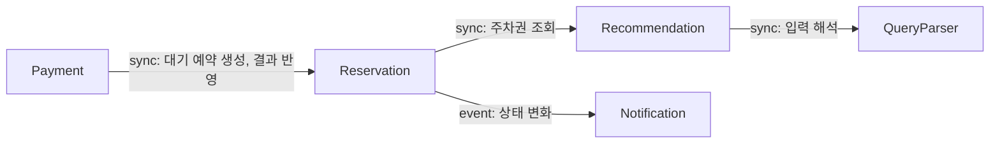

# 컴포넌트 카탈로그

## Sources

- [desc] Initial description: 사용자가 음성 텍스트('강남역 근처 2시간 주차권 찾아줘')를 보내면 최적 주차권을 추천하고 결제와 예약을 처리하는 VoiceParking 프로토타입. 백엔드 모듈이 여럿이면 마이크로서비스로 나눈다. 결제가 끝나면 사용자에게 바로 예약 완료를 보여 준다.
- [scope] Workflow-selected scope: classic
- [Q1] 컴포넌트는 QueryParser, Recommendation, Reservation, Payment, Notification의 5개로 나눈다
- [memory:M1] requirements.md (FR1~FR9, NFR1~NFR9), stories.md (US1.1~US5.1), team-practices.md (Docker 금지, 로컬 실행 스크립트)

배포 단위(서비스를 몇 개로 묶을지)는 이 단계에서 정하지 않는다. 다음 단계 Units Generation에서 결정한다.

```yaml
components:
  - name: QueryParser
    summary: 음성 텍스트에서 장소와 이용 시간을 추출한다
    behaviour: >
      한국어 한 문장에서 장소(목업 데이터에 등록된 이름)와 이용 시간(시간 단위)을 추출한다.
      장소 또는 시간이 없으면 무엇이 빠졌는지 알려 주는 결과를 돌려주고 추천을 진행시키지 않는다.
      음성 인식(STT)은 하지 않으며 이미 텍스트인 입력만 받는다.
    responsibilities:
      - 장소와 이용 시간 추출
      - 입력 부족 사유 판정
    depends_on: []
    dependents:
      - component: Recommendation
        interaction: 추천 요청 시 입력 문장을 해석한다
    external_dependencies: []
    entities: []

  - name: Recommendation
    summary: 조건에 맞는 주차권 후보를 찾고 종합 점수로 최적 1개와 비교 후보 2개를 정한다
    behaviour: >
      요청 장소 주변 목업 주차권 중 사용 가능 시간이 요청 시간을 포함하는 것만 후보로 둔다.
      종합 점수 = 가격 0.4 + 거리 0.4 + 시간 적합도 0.2 (각 항목은 후보 간 min-max 0~100 환산).
      동점이면 가격이 낮은 후보를 앞세운다. 후보가 3개 미만이면 있는 만큼만 돌려준다.
      각 추천에 가장 큰 기여 항목을 설명하는 이유를 붙인다. 주차장과 주차권 데이터를 소유한다.
    responsibilities:
      - 후보 조회와 제외
      - 종합 점수 계산과 순위 결정
      - 추천 이유 생성
      - 주차장·주차권 목업 데이터 소유
    depends_on:
      - component: QueryParser
        interaction: 입력 문장에서 장소와 이용 시간을 얻는다
        style: sync
    dependents:
      - component: Reservation
        interaction: 예약 생성 시 선택된 주차권의 가격과 주차장 정보를 조회한다
    external_dependencies:
      - name: 내장 DB 또는 인메모리 저장소
        kind: database
        purpose: 목업 주차장·주차권 데이터 보관
    entities:
      - name: ParkingLot
        identifier: lotId
        attributes: [lotId, name, placeName, distanceMeters]
      - name: ParkingPass
        identifier: passId
        attributes: [passId, price, availableFrom, availableUntil]
        references:
          - entity: ParkingLot
            owned_by: Recommendation
            relationship: 각 주차권은 하나의 주차장에 속한다

  - name: Reservation
    summary: 예약의 상태를 소유하고 승인 지연 180초 자동 취소를 수행한다
    behaviour: >
      예약은 결제 대기, 예약 완료, 결제 실패, 취소 중 하나의 상태를 갖는다.
      결제 요청 시점부터 180초 안에 승인이 없으면 취소하며 취소 허용 오차는 ±2초다.
      승인과 취소가 경계에서 겹치면 먼저 확정된 쪽이 이기고, 이미 취소된 예약에 온 승인은 되살리지 않는다.
      결제 결과 반영은 하나의 원자 연산(applyPaymentResult)이다. 예약이 아직 결제 대기이면 결과(승인 또는 실패)를 적용해 "적용됨"을 돌려주고,
      이미 완료·실패·취소된 예약이면 상태를 바꾸지 않고 "거부됨(현재 상태 포함)"을 돌려준다. 자동 취소도 같은 규칙으로 결제 대기일 때만 적용된다.
      상태가 바뀔 때마다 현재 상태 전체(스냅샷)를 Notification에 밀어 넣는다. 세션별 현재 예약 상태는 화면이 직접 조회할 수도 있다.
      세션당 결제 대기 예약은 1건으로 제한한다.
    responsibilities:
      - 예약 상태 전이와 단일 확정 지점
      - 180초 타이머와 자동 취소
      - 세션별 예약 조회
    depends_on:
      - component: Recommendation
        interaction: 선택된 주차권의 가격과 주차장 정보를 조회한다
        style: sync
      - component: Notification
        interaction: 예약 상태 변화를 화면으로 푸시하도록 알린다
        style: event
    dependents:
      - component: Payment
        interaction: 결제 요청 시 대기 예약을 만들고 승인·실패 결과를 원자 연산으로 반영한다
    external_dependencies:
      - name: Reservation 전용 내장 DB 또는 인메모리 저장소 (다른 컴포넌트와 공유하지 않음)
        kind: database
        purpose: 예약 상태와 결제 요청 시각 보관
    entities:
      - name: Reservation
        identifier: reservationId
        attributes: [reservationId, sessionId, status, amount, paymentRequestedAt, confirmedAt, cancelledAt]
        references:
          - entity: ParkingPass
            owned_by: Recommendation
            relationship: 각 예약은 하나의 주차권을 예약한다

  - name: Payment
    summary: 모의 PG에 결제를 요청하고 승인·실패 웹훅을 멱등하게 처리한다
    behaviour: >
      결제 요청을 받으면 Reservation에 대기 예약을 만든 뒤 모의 PG에 요청한다.
      모의 PG의 승인·실패는 비동기 웹훅으로 들어오며 공유 비밀 값으로 검증한다.
      잘못된 비밀 값이면 거부하고 상태를 바꾸지 않으며 기록한다.
      같은 승인 이벤트가 여러 번 와도 예약 확정은 1회만 일어나게 이벤트 ID로 걸러 낸다.
      웹훅 결과를 Reservation의 원자 연산(applyPaymentResult)으로 전달하고, 돌려받은 결과가 "거부됨"이면 무시했다고 기록한다.
      Payment가 예약 상태를 먼저 읽고 판단하지 않는다. 판단은 Reservation만 한다.
      Payment.status는 PG가 알려 준 결과(요청됨, 승인, 실패, 무시됨)를 기록하는 값이며 사용자에게 보이는 예약 상태의 기준은 Reservation.status다.
      모의 PG에서 승인, 지연, 실패 시나리오를 고를 수 있다.
    responsibilities:
      - 결제 요청 전송
      - 웹훅 검증과 멱등 처리
      - 승인·실패 결과를 예약에 반영
    depends_on:
      - component: Reservation
        interaction: 대기 예약을 만들고 승인·실패 결과를 원자 연산으로 반영한다 (적용됨 또는 거부됨 결과를 돌려받는다)
        style: sync
    dependents: []
    external_dependencies:
      - name: 모의 PG
        kind: third-party-api
        purpose: 결제 승인 요청과 비동기 웹훅 발송
      - name: 내장 DB 또는 인메모리 저장소
        kind: database
        purpose: 결제 상태와 처리한 웹훅 이벤트 보관
    entities:
      - name: Payment
        identifier: paymentId
        attributes: [paymentId, reservationId, status, requestedAt]
        references:
          - entity: Reservation
            owned_by: Reservation
            relationship: 각 결제는 하나의 예약에 속한다
      - name: WebhookEvent
        identifier: eventId
        attributes: [eventId, paymentId, outcome, receivedAt, ignored]
        references:
          - entity: Payment
            owned_by: Payment
            relationship: 각 웹훅 이벤트는 하나의 결제에 대한 통지다

  - name: Notification
    summary: 화면의 SSE 구독을 관리하고 예약 상태 변화를 푸시한다
    behaviour: >
      화면이 예약 ID로 구독하면 SSE 연결을 유지하고, Reservation이 밀어 넣는 상태 스냅샷을 받으면 해당 구독에 즉시 푸시한다.
      Notification은 Reservation을 호출하지 않는다. 받은 가장 최근 스냅샷을 보관해 두었다가, 연결이 끊겨 다시 구독하면 그 스냅샷을 먼저 한 번 보내 준다.
      보관한 스냅샷이 없으면(서버 재시작 등) 화면이 Reservation에서 현재 상태를 직접 조회한다.
      웹훅 수신 시각부터 화면 표시까지 1초 이내를 목표로 한다.
    responsibilities:
      - SSE 구독 관리
      - 상태 변화 푸시와 재구독 시 현재 상태 재전송
    depends_on: []
    dependents:
      - component: Reservation
        interaction: 예약 상태 변화를 알려 푸시를 요청한다
    external_dependencies: []
    entities:
      - name: Subscription
        identifier: subscriptionId
        attributes: [subscriptionId, sessionId, reservationId, connectedAt, lastSnapshot]
        references:
          - entity: Reservation
            owned_by: Reservation
            relationship: 각 구독은 하나의 예약 상태를 지켜본다 (조회가 아니라 Reservation이 밀어 넣은 스냅샷을 보관)
```

## Component Diagram



## Component Summary

| Component | Purpose | Depends On | Dependents | Entities Owned |
|---|---|---|---|---|
| QueryParser | 장소·시간 추출 | 없음 | Recommendation | 없음 |
| Recommendation | 후보 조회, 점수, 순위 | QueryParser | Reservation | ParkingLot, ParkingPass |
| Reservation | 예약 상태, 180초 자동 취소 | Recommendation, Notification | Payment | Reservation |
| Payment | 결제 요청, 웹훅 멱등 처리 | Reservation | 없음 | Payment, WebhookEvent |
| Notification | SSE 푸시 | 없음 | Reservation | Subscription |

## Entity Ownership

| Entity | Owning Component | Identifier | Attributes | References |
|---|---|---|---|---|
| ParkingLot | Recommendation | lotId | lotId, name, placeName, distanceMeters | 없음 |
| ParkingPass | Recommendation | passId | passId, price, availableFrom, availableUntil | ParkingLot |
| Reservation | Reservation | reservationId | reservationId, sessionId, status, amount, paymentRequestedAt, confirmedAt, cancelledAt | ParkingPass |
| Payment | Payment | paymentId | paymentId, reservationId, status, requestedAt | Reservation |
| WebhookEvent | Payment | eventId | eventId, paymentId, outcome, receivedAt, ignored | Payment |
| Subscription | Notification | subscriptionId | subscriptionId, sessionId, reservationId, connectedAt, lastSnapshot | Reservation |

## External Dependencies

| Component | Dependency | Kind | Purpose |
|---|---|---|---|
| Recommendation | 내장 DB 또는 인메모리 저장소 | database | 목업 주차장·주차권 데이터 |
| Reservation | 내장 DB 또는 인메모리 저장소 | database | 예약 상태와 결제 요청 시각 |
| Payment | 모의 PG | third-party-api | 결제 승인 요청, 비동기 웹훅 발송 |
| Payment | 내장 DB 또는 인메모리 저장소 | database | 결제 상태와 처리한 웹훅 이벤트 |

## Rationale

| Component | 별도 컴포넌트인 이유 |
|---|---|
| QueryParser | 입력 해석 규칙(한국어 문장 처리)은 다른 부분과 변경 이유가 다르고 데이터를 소유하지 않는다 |
| Recommendation | 주차장·주차권 데이터와 점수 규칙을 소유하며 요금 정책이 바뀔 때 함께 바뀐다 |
| Reservation | 예약 상태와 180초 경계 규칙의 단일 확정 지점이다. 확정과 취소 경합을 한 곳에서만 판정해 경계 동시성을 한 곳에서 시험한다 |
| Payment | 외부 모의 PG와의 통신, 웹훅 검증, 멱등 처리라는 별도 변경 이유와 데이터를 가진다 |
| Notification | 화면 연결 관리와 푸시는 비즈니스 규칙과 수명이 다르며 1초 이내 전달 목표가 따로 있다 |

### Alternatives Rejected

- 3개 통합안(Search, Booking, Notification): 결제 웹훅 처리와 예약 타이머가 한 덩어리가 되어 180초 경계 동시성 시험이 복잡해져서 선택하지 않았다. 사용자가 5개 세분화안을 선택했다 ([Q1]).
- Payment가 Reservation을 호출하는 방향 대신 Reservation이 Payment를 호출하는 방향: 결과 반영에서 Payment가 Reservation을 다시 호출해야 해서 순환이 생기므로 선택하지 않았다.

## Assumptions & Open Questions

- [assumption] 세션 식별자(sessionId)는 Reservation의 속성으로 저장하고 별도 세션 컴포넌트를 두지 않는다. 근거: 로그인 없음, 세션 단위 익명 사용자.
- [assumption] 모의 PG는 이 시스템이 만드는 컴포넌트가 아니라 외부 의존성으로 본다. 어떤 프로세스로 띄울지는 Units Generation에서 정한다.
- 열린 질문: 결제 실패 후 실패한 후보를 다시 고를 수 있는지는 Functional Design에서 정한다.
- 열린 질문: 서비스 배포 단위를 몇 개로 묶을지는 Units Generation에서 정한다.
